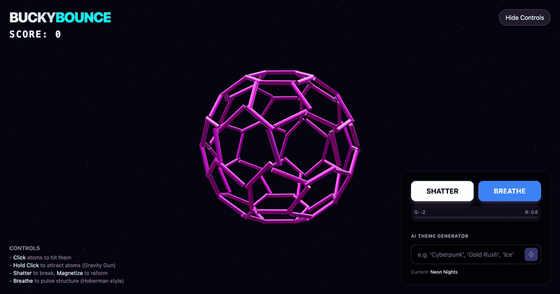
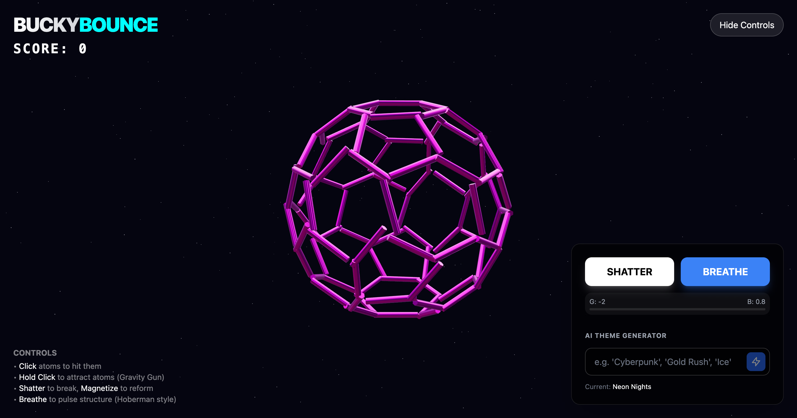
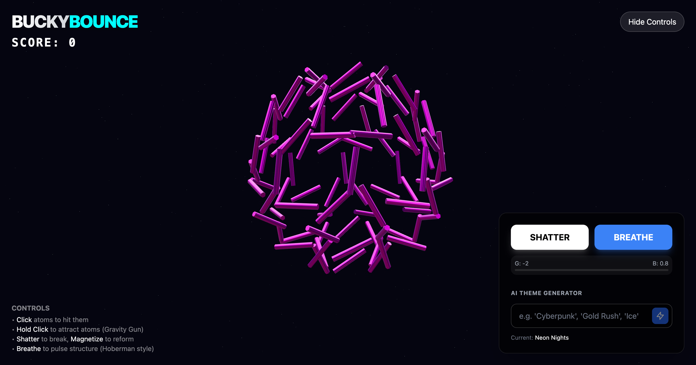

# BuckyBounce AI



A physics-driven buckyball (C₆₀ fullerene) you can click, shatter, and reassemble in the browser. Spring-based forces hold the geodesic structure together while gravity, a Hoberman-style breathing animation, and your mouse pull it apart. Type a theme like "Cyberpunk" or "Gold Rush" and Gemini rewrites the colors in real time.



## Quick Start

```bash
git clone https://github.com/andrewvoirol/ais-buckybounce-ai.git
cd ais-buckybounce-ai
npm install
npm run dev
```

> Requires Node.js ≥ 18. Set `GEMINI_API_KEY` in `.env.local` for AI themes.

## How It Works

**Click** atoms to score points and knock them around. **Hold click** to activate the gravity gun and pull atoms toward your cursor. Hit **Shatter** to blow the structure apart, then **Magnetize** to snap it back together. Toggle **Breathe** for a Hoberman-sphere pulsing animation. The controls panel also has gravity and bounce sliders.

Under the hood, 60 atoms sit at truncated-icosahedron vertices, connected by 90 spring-constraint struts rendered as 3D cylinders. React Three Fiber + Cannon.js handle the scene graph and physics. A shared `AudioContext` plays procedural synth hits on click with cooldown and concurrency caps to prevent audio spam.



## Tech Stack

| Layer | Tech |
|-------|------|
| Framework | React 19 + TypeScript |
| 3D | Three.js via React Three Fiber |
| Physics | Cannon.js via @react-three/cannon |
| Styling | Tailwind CSS 3 |
| AI | Google Gemini (@google/genai) |
| Build | Vite 6 |

## Project Structure

```
├── App.tsx              # Global state, score, combo, controls UI
├── components/
│   └── BuckyballScene.tsx  # R3F scene: atoms, struts, springs, physics
├── services/
│   └── geminiService.ts    # Gemini API for AI theme generation
├── utils.ts             # Shared AudioContext, synth, geometry math
├── types.ts             # TypeScript interfaces
└── index.html           # Entry point
```

## License

MIT
