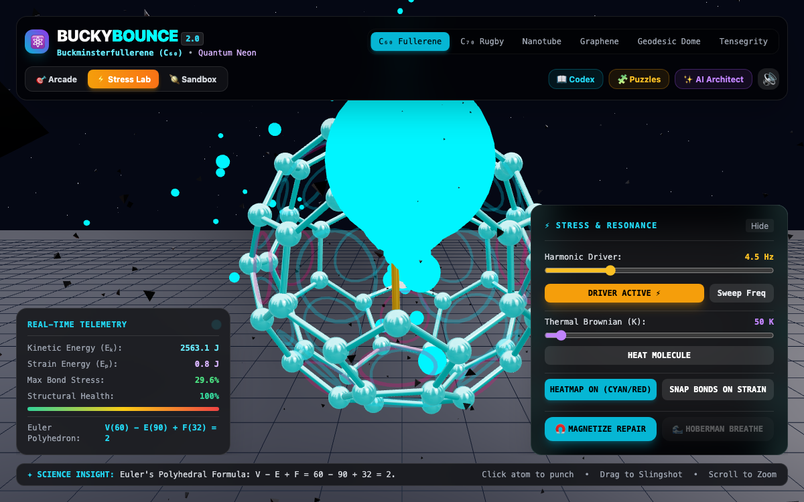

# BuckyBounce 2.0 — Molecular Physics & Structural Science Simulator


An interactive 3D physics playground and structural mechanics laboratory where you explore, deform, and shatter authentic nanoscale geometries — from the 60-atom $C_{60}$ Buckminsterfullerene to Carbon Nanotubes, Graphene Monolayers, and floating Tensegrity Icosahedrons. Launch high-speed particle probes through glowing Euler target rings, stress-test allotropes with harmonic resonance sweeps, and generate custom celestial environments with Google Gemini AI.


## Quick Start

```bash
git clone https://github.com/andrewvoirol/ais-buckybounce-ai.git
cd ais-buckybounce-ai
npm install
npm run dev
```

> Node.js ≥ 18. (Optional: configure `VITE_GEMINI_API_KEY` in `.env.local` to unlock custom Gemini 2.5 material architecture prompts).

## How It Works

1. **Launch Probes & Score Combos**: Click **Fire Energy Probe** or drag anywhere on the canvas to slingshot high-speed probes. Watch probes ricochet elastically off molecular nodes and thread glowing holographic rings ($12$ pentagons on $C_{60}$) to trigger procedural pentatonic musical chimes and explosive combo multipliers.
2. **Stress & Resonance Lab**: Switch to **Stress Lab** mode to activate the harmonic oscillator driver. Tune the driving frequency ($\omega$) or hit **Sweep Freq** to find natural eigenfrequencies, observe real-time Hooke's law strain heatmaps (cyan $\to$ yellow $\to$ red), and trigger covalent bond snapping on excessive yield stress.
3. **Interactive Science Codex**: Open the **Codex** to dive into Euler's Polyhedral Formula ($V - E + F = 2$), the 12-pentagon curvature theorem, $sp^2$ vs $sp^3$ hybridization, space-elevator carbon nanotube physics, and tensegrity equilibrium.
4. **Shatter & Laser Synthesis**: Hit **Shatter** to break the molecular lattice into free-flying debris, then hit **Magnetize Repair** or click individual disconnected atoms to laser-weld covalent bonds back into place.


### Geometrical Structure Models

* **$C_{60}$ Buckminsterfullerene**: 60 atoms, 90 bonds, 12 pentagons, 20 hexagons ($V - E + F = 2$).
* **$C_{70}$ "Rugby Ball" Fullerene**: 70 atoms, 105 bonds, 12 pentagons, 25 hexagons ($V - E + F = 2$).
* **Carbon Nanotube (SWCNT)**: $(5,5)$ armchair chiral rolled graphene cylinder with periodic boundary rings.
* **Graphene Monolayer Sheet**: 2D honeycomb lattice with pinned perimeter boundary anchors and flexural acoustic wave propagation.
* **Geodesic Sphere Dome**: Triangulated icosahedral dome with pinned foundation ground pins.
* **Tensegrity Icosahedron**: 6 floating isolated compression struts suspended in a continuous 24-cable tension network.



## Tech Stack

| Component | Technology |
|---|---|
| Framework | React 19 + TypeScript |
| 3D Graphics | Three.js via `@react-three/fiber` & `@react-three/drei` |
| Physics Engine | Sub-stepped Hooke's Law spring-mass solver & elastic momentum transfer |
| Audio Engine | Web Audio API procedural synthesizer (FM impacts, chimes, laser welds) |
| Styling | Tailwind CSS |
| AI Integration | Google Gemini 2.5 Flash via `@google/genai` |
| Build Tool | Vite 6 |

## Controls & Shortcuts

* **Drag on Canvas / Click "Fire Energy Probe"**: Aim and release high-speed probe ricochets.
* **Click Node**: Impulse punch / Laser-weld disconnected atoms.
* **Spacebar / F**: Fire probe.
* **1 – 6**: Quick switch structures ($C_{60}, C_{70}$, Nanotube, Graphene, Geodesic, Tensegrity).
* **M**: Toggle procedural audio mute.
* **Scroll / Right-Drag**: Orbit, rotate, and zoom the 3D camera.

## License

MIT
